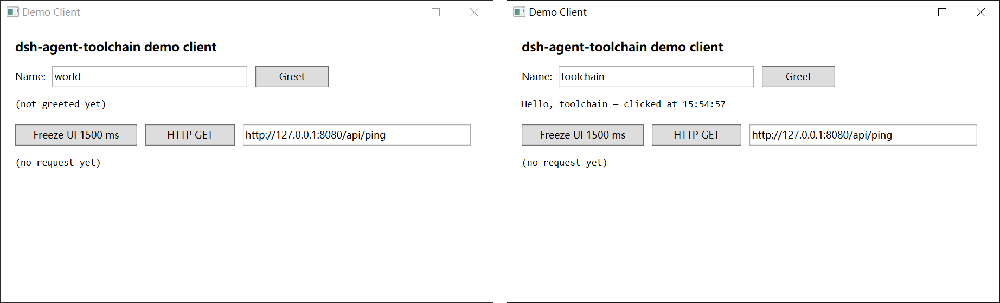
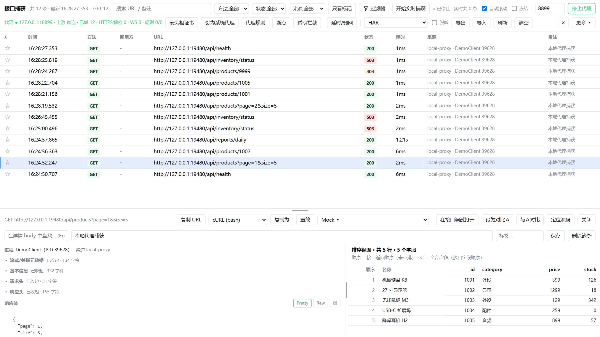
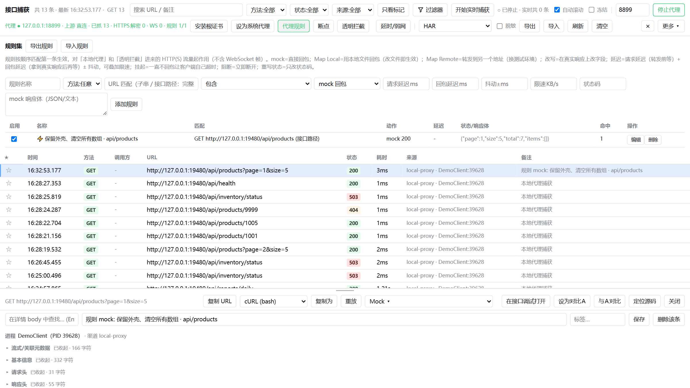
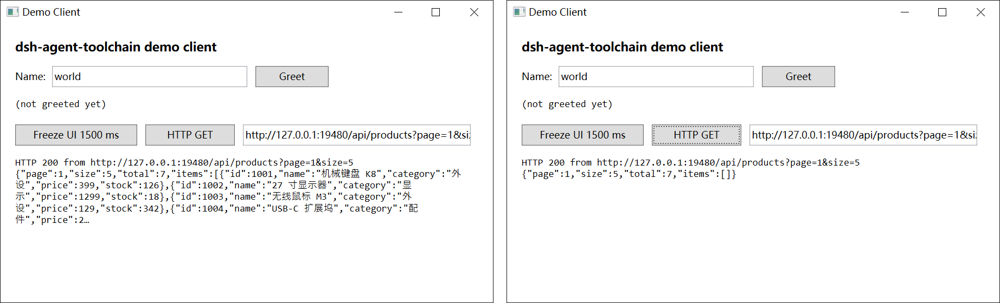
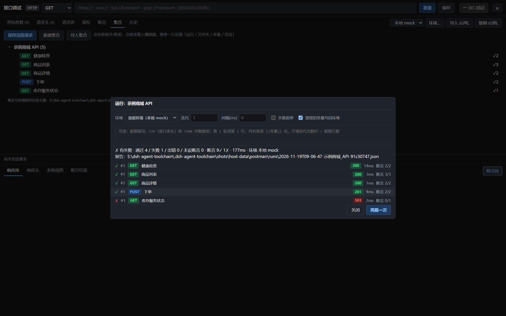

# dsh-agent-toolchain

**让编程 Agent 改完代码后，能对着正在运行的程序自己检查一遍，并把证据留下来。**

[](./LICENSE)
[](https://github.com/lemonmmice/dsh-agent-toolchain/releases)
[](https://nodejs.org)
[](./mcp/README.md)

这是一组插件加一个 MCP 服务。装上之后，编程 Agent 不只会写代码，还能**看到**正在运行的 Windows 桌面程序、**操作**它、**测量**它的性能、**抓下**它发出的网络请求，用这些来确认自己刚改的东西真的生效了。每个插件都是一块独立的积木；合在一起，就把「Agent 写了改动」和「改动确实能用」接上了，检查过程中的构建日志、截图、抓包、dump 都落盘留证。

适合谁看：

- **做 .NET / WPF 桌面客户端的开发者**：想让 Claude Code、Cursor、Codex 这类 Agent 能自己编译、点界面、看接口、查卡顿。
- **面试官**：这是我在公司实际用来开发和排查一个大型 WPF 金融客户端的工具链，下面的截图都是在仓库自带的示例程序上真实跑出来的（没有用公司客户端）。

## 实际跑出来是什么样

下面所有截图的被测对象都是仓库里的 [samples/DemoClient](./samples/DemoClient)（一个很小的 WPF 窗口），加上一个本地起的「示例商城」mock 接口（127.0.0.1:19480，有商品列表、详情、下单、一个故意慢 1.2 秒的报表接口、一个故意返回 503 的库存接口）。工具调用全部走 MCP，和 Claude Code 调用时是同一条路径。

### 1. UI 驱动：Agent 自己填表、点按钮、读结果

Agent 用 `ui_observe` 读出窗口里的控件（按名字或 AutomationId 定位），用 `ui_drive` 往输入框里填 `toolchain`、点 Greet，再把结果读回来、截图留证。左边是操作前，右边是操作后：



点击、输入这类有副作用的操作必须显式传 `allowSideEffects=true`；只读的观察随时可以调。输入后会读回校验，值没落进去就报失败，不会假装成功。

### 2. 接口捕获：客户端到底调了什么接口

客户端走本地捕获代理（只给 DemoClient 设了 `HTTP_PROXY`，没改系统代理）。面板里能看到每条请求的方法、状态码、耗时和来源进程（`DemoClient:PID`）。选中一条，下面是请求/响应详情，右边的「排序视图」把响应里的列表按字段展开成表格：



Agent 这边对应的是 `capture_query`：可以按「只看错误」「耗时超过 1 秒」「某个 host」「某个 ViewModel 发起的」这些条件查，不用自己翻日志。

### 3. Mock：不改后端，直接改客户端收到的响应

在详情里选「Mock → 保留外壳·清空所有数组」，就生成了一条代理规则：商品列表接口的外层结构不变，但所有数组都变成空的。用来测客户端的空列表态，不需要后端配合：



规则生效前后，客户端收到的同一个接口（左边是真实数据，右边 `items` 变成了 `[]`）：



同一套规则还支持：返回 500/404、超时、断开连接、延迟、映射到本地文件或另一个环境、按脚本改写响应字段，以及全局弱网模拟（2G/3G/高延迟等预设）。Agent 用 `capture_rules` / `capture_netsim` 调用。

### 4. 接口调试：集合、断言、一键跑完

内置一个类似 Postman 的接口调试面板。下面是「示例商城 API」集合：5 个请求，每个带断言（状态码、JSON 字段等），有的还会提取变量给后面的请求用（比如列表里第一个商品的 id 传给详情，下单返回的订单号存进环境）。一键运行，库存接口返回 503，断言把它抓了出来：



每次运行的完整报告落盘成 JSON。Agent 用 `http_collection` 做同样的事：保存请求、设置断言和提取、运行集合，只有全部断言通过才算 `pass`，没跑断言的结果是 `unchecked` 而不是「通过」。

### 5. 编译检查：错误直接给到文件和行

在示例程序里故意改坏一行（少个分号），`build_run` 返回结构化的错误，而不是一大段 MSBuild 日志：

```json
{
  "ok": false,
  "summaryLine": "1 error(s), 0 warning(s)",
  "errors": [
    {
      "file": ".../BrokenDemo/MainWindow.xaml.cs",
      "line": 36,
      "col": 35,
      "code": "CS1002",
      "message": "应输入 ;"
    }
  ]
}
```

还有一个细节：如果要编译的正好是正在运行的客户端本身，`build_run` 会先拒绝并说明原因（输出文件会被锁定，导致 MSB3021/3027），而不是跑出一堆看不懂的复制失败。

### 6. 一条命令跑完整个闭环

```bash
npm run demo          # 构建 → 启动 → 操作 → 读回
npm run demo:perf     # 再加一步：抓一次故意卡住的 UI 线程
```

`npm run demo` 的真实输出（省略开头横幅）：

```
1. environment self-check
  ok   toolchain_status reports what is configured  (toolchain_status, 542 ms)

2. build the sample app (and bind the result to a runId)
  ok   build_run → 0 errors  (build_run, 3353 ms)

3. launch and look at the real window
  ok   ui_launch brings the window up  (ui_launch, 11929 ms)
  ok   ui_observe(state) sees the controls  (ui_observe, 62 ms)

4. drive it — this is the part a code-reading agent cannot do
  ok   type into the Input box  (ui_drive, 458 ms)
  ok   click Greet  (ui_drive, 314 ms)
  ok   read the result back out of the UI  (ui_observe, 79 ms)
  ok   capture a screenshot as evidence  (ui_observe, 35 ms)

steps: 8/8 ok
```

`npm run demo:perf` 还会报出 `stutterCount=1, maxMs=1474`：示例程序故意把 UI 线程卡 1500 ms，性能探针必须把它抓到。

> demo 不是专门写来演示的代码。`mcp/demo/run-demo.mjs` 就是一个普通的 MCP 客户端：它通过 stdio 拉起 `mcp/server.mjs`，调用的工具和 Claude Code、Cursor、Cline、Codex 调用的完全一样。它能跑通，MCP 这一面就是好的。

## 要解决的问题

编程 Agent 很会写补丁，但补丁之后发生了什么它看不见：构建是不是坏了？新页面真的渲染出来了吗？程序发了哪些接口，有没有哪个卡了 20 秒？这次改动有没有带来内存泄漏或界面卡顿？

传统做法是让 Agent 读代码来验证。这套工具链让它像测试工程师一样**观察正在运行的程序**来验证，并把证据（构建日志、截图、抓包、dump）留在磁盘上。

## 闭环

```
  改代码 → 构建 (dsh-build) → 操作客户端 (dsh-ui-drive)
                               → 抓包 / mock 接口 (dsh-api-visualizer)
                               → 重放请求、跑集合 (dsh-postman)
                               → 查性能 (dsh-perf) / 查卡死 (dsh-hang-inspector)
                               → 记住经验 (dsh-memory)
  失败自动记录 → 失败语料库（数据飞轮，内部使用）
  值得保留的经验 → harness_trial (Harness²) → 验证过的项目技能（可选）
```

## 快速开始

### 路线 A：跑 demo（不需要 Rust，大约五分钟）

`npm run demo` 用到的工具（`toolchain_status`、`build_run`、`ui_launch` / `ui_observe` / `ui_drive`，加 `--with-perf` 时还有 `perf_probe`）**既不需要 Rust 也不需要 MSVC**，`http_request` 也不需要。这一点在 `plugins/*/bin/` 全空的检出上验证过。

1. Node.js 20+ 和 .NET SDK（示例程序目标框架是 `net10.0-windows`）。
2. `npm install --prefix mcp`：只有 MCP 服务有依赖。
3. `npm run demo`。

除了示例程序自己的构建输出（`samples/DemoClient/bin/` 和 `obj/`，已 gitignore），一次 demo 的截图、构建日志和失败记录都放在 `.dsh-agent-toolchain/demo/`（已 gitignore）。

### 路线 B：完整桌面模式

可以用 `npm run build:runtime` 构建一个可选的独立 Rust MCP 运行时。它不依赖 Node 就能提供 HTTP、后台任务和证据发布，也能通过懒加载的 Node 兼容桥保留完整的工具目录。详见 [Rust 运行时的范围、部署和验证](./docs/native-runtime.md)。

抓包存储、记忆索引和火焰图折叠要加载 Rust Node-API 模块，终端检查器要跑一个小的 Rust 辅助程序。按需构建（需要 Rust + Visual C++ 构建工具），或者用已经带了这些产物的部署：

```bash
npm run build:capture-store        # dsh-api-visualizer（dsh-verify 也共用）
npm run build:memory-store         # dsh-memory
npm run build:trace-fold           # dsh-perf 火焰图折叠
npm run build:terminal-inspector   # dsh-win-terminal-inspector
```

然后 `pwsh -File install.ps1` 先空跑一遍，`pwsh -File install.ps1 -Apply` 把插件和 `lib/` 复制进你的 DSH profile。在 `cordis.patch.yml` 里注册（见下面的[安装细节](#安装细节)）和重启宿主需要你自己做，脚本会把这两步作为下一步打印出来。

## 只读代码的 Agent 做不到的事

- **分清「0 个错误」和「这个文件真的被编译了」。** 老式 `.csproj` 不会自动包含新加的 `.cs` 文件，所以构建可能报成功，而你的文件根本没参与编译。`build_compile_check` 专门回答这个问题，有三种结果：在编译集里、不在、**判断不了**（有没求值的条件、输入缺失或有歧义；绝不会悄悄当成「不在」）。它是静态读项目文件，不是 MSBuild 求值。
- **操作并观察真实的程序。** `ui_observe` / `ui_drive` / `ui_flow` 按名字或 AutomationId 找控件，点击、输入、等待条件、读回值、按窗口截图。只读操作不需要授权；任何点击或输入都必须传 `allowSideEffects=true`，还有一个可选的快照新鲜度门，会拒绝针对过期界面的操作。
- **Jev 辅助的 UI 决策。** `ui_jev` 把脱敏后的 UIA 控件列表发给 Jev，每一步让它从有限的候选里挑一个（最多 `maxSteps` 步），再交给同一个确定性的 UI 执行器和安全门去执行。没有 `allowRemoteData=true` 什么都不发，没有 `allowSideEffects=true` 什么都不执行。Jev 收不到像素，不能生成任意输入，也绕不过授权；见 [docs/jev-ui.md](./docs/jev-ui.md)。
- **看不到就说「未验证」，不说「通过」。** 工具看不到某样东西时，会报告为未检查，而不是编一个绿色结果：枚举结果为空表示「没读到」，不是「什么都没有」；构建报 0 个错误，和「你的文件被编译了」也不是同一个结论。

## 工具：共 68 个，其中 25 个只读

唯一的事实源是 [`lib/tool-registry.mjs`](./lib/tool-registry.mjs)；两种接入方式（DSH 插件和 MCP）都从它生成，所以不会对不上。**全部工具每个一行、按「你想做什么」分组 → [docs/tools.md](./docs/tools.md)。**

| 插件 | 给 Agent 提供什么 |
| --- | --- |
| [dsh-build](./plugins/dsh-build/README.md) | 把 MSBuild / `dotnet build` 变成工具：增量构建、结构化错误列表（文件/行/列/错误码）、重新解析错误、编译集成员检查。构建默认值按仓库结构自动判断（老客户端的布局保持原有默认值不变；普通仓库自动识别 `.sln`/`.slnx` 和平台）。另外提供可选的 `dev_*` 工具：C# 语言服务查询、本地日志检索、.NET 技能、保留编码的文件读写、公开文档查询和 PNG 对比。 |
| [dsh-ui-drive](./plugins/dsh-ui-drive/README.md) | 通过 UIA 操作运行中的 Windows 桌面客户端：查找/点击/输入/读取/截图、可视树导出、带断言和回放的多步流程。截图以文件形式返回，由调用方的模型自己去看；只有在显式开启的点击兜底里才会用到视觉模型。 |
| [dsh-verify](./plugins/dsh-verify/README.md) | 工具链状态和 Harness²：`toolchain_status` / `toolchain_job` 环境自检和任务控制，以及 `harness_trial` / `harness_experience`。（名字为了保持 id 稳定没改，它已经不做验证了。） |
| [dsh-api-visualizer](./plugins/dsh-api-visualizer/README.md) | 抓客户端的 HTTP 流量：实时面板、JSONL 存储（可按客户端分库）、调用方归因、保存的过滤器、基线/契约回归、导出 Markdown 给 AI 分析、可选的 Fiddler 式本地代理，以及给不认代理设置的客户端用的透明拦截（改 hosts 文件重定向，需要管理员权限或 UAC 弹窗，并注册一个 SYSTEM 兜底计划任务）。经过代理或透明拦截的流量可以 mock、映射到本地文件或另一个主机、改写、断点暂停或限速。 |
| [dsh-postman](./plugins/dsh-postman/README.md) | 宿主里的 Postman 式 HTTP 客户端：从宿主侧发请求（没有浏览器 CORS 限制）、历史记录、带文件夹的集合、环境、断言和变量提取、集合运行器、WebSocket 客户端，以及 `http_request` / `http_collection` 两个 Agent 工具。 |
| [dsh-perf](./plugins/dsh-perf/README.md) | UI 卡顿测量（窗口消息往返延迟、P50/P95/P99、卡顿事件）、完整 dump 采集 + ClrMD 分析、托管堆统计、GC 根引用链、ETW 采样 / 热点调用栈 / 火焰图和分配折叠、UI 冻结（墙钟时间）分析、按线程/时间窗口/方法分组的离线 CPU 采样拆解。 |
| [dsh-hang-inspector](./plugins/dsh-hang-inspector/README.md) | 卡死诊断：监测主窗口响应、自动收集证据包（冻结截图、时间线、进程信息、网络 trace 尾部、dump），分析托管线程栈并把卡死位置映射到项目源码。 |
| [dsh-memory](./plugins/dsh-memory/README.md) | 宿主的长期记忆：对已索引的工作区文档做语义搜索、跨会话的键值约定、按修改时间增量索引、淘汰过期分块、保存时过滤 token 和密钥。 |
| [dsh-win-terminal-inspector](./plugins/dsh-win-terminal-inspector/README.md) | 检查常驻 shell 的 Windows 终端（ConPTY）。 |
| [dsh-jev](./docs/jev-integration.md) | 可选的 TypeSafe Jev 决策层：批量的类型化路由/证据判断，需要显式同意才发送远程数据；只给建议，从不执行它选中的动作。 |

**几个要点**

- **一套工具，所有 Agent 通用**：同样的工具既驱动 DeepSeek Harness 插件，**也**给任何 MCP 客户端用，见 [mcp/](./mcp/README.md)。Claude Code、Cursor、Cline 和 Codex 用的是完全相同的 `lib/` 代码。抓包控制、mock、透明拦截和弱网模拟会转发给持有抓包引擎的 DSH 宿主，所以需要宿主在运行。
- **UI 自动化安全优先**：`click`/`setvalue`/`key` 必须显式传 `allowSideEffects=true`；只读操作永远安全。所有操作之上还有一个运维急停开关和一个可选的默认拒绝策略，而且恢复急停故意没有做成 Agent 工具。
- **测量结果说实话**：性能数据来自真实的窗口消息往返，每份报告都会写明这个方法**看不到**什么；成本表不知道就写「未知」，不编数字；枚举为空报告为「没读到」，绝不说成「什么都没有」。
- **失败语料库是护城河**：失败路径按固定的 7 类分类自动记录。两种接入方式都会记录构建错误和 `ui_flow` 失败（断言或操作步骤），MCP 这一面还会记录失败的 UI 操作、发不出去的 HTTP 请求、失败的卡死分析，以及 `perf_probe` 抓到的 UI 卡顿。语料库是运行时写的内部存储，没有 Agent 能调用的工具去读写它。见 [docs/failure-corpus.md](./docs/failure-corpus.md)。
- **控制接口只监听本机回环**。和环境相关的值（客户端 exe、窗口标题、证据目录、工具路径、源码根）都是带合理默认值的环境变量：不写死机器，不内嵌凭据。唯一固定的值是 MCP 这一面访问 DSH 宿主的地址 `127.0.0.1:3080`。只有一个需要主动开启的工具会改系统配置：`capture_intercept start` 会修改系统 hosts 文件（宿主没提权时会弹 UAC），并注册一个 SYSTEM 计划任务，在重启或监听进程消失时移除拦截；`stop` 会还原 hosts 文件。

## 任何 MCP 客户端都能用

```bash
claude mcp add --scope user dsh-agent-toolchain -- cmd /c node <repo>\mcp\server.mjs
```

Cursor、Cline 等其他 stdio 客户端用同样的命令。配置细节、进度通知、输出预算和平台支持矩阵见 [mcp/README.md](./mcp/README.md)。

## 作为 Agent 插件安装（MCP 服务 + 技能 + 钩子）

仓库根目录本身也是一个插件（`.claude-plugin/plugin.json`，由 `.claude-plugin/marketplace.json` 列出）。装一次会同时带来三样东西：

- **MCP 服务**：通过 `mcp/launch.mjs` 启动。首次启动时如果缺 `node_modules` 会自动安装 MCP SDK，并从 `~/.dsh-agent-toolchain/env.json` 读取本机配置（用 `DSH_ENV_FILE` 换位置，设为 `none` 关闭；只读字符串类型的 `DSH_*`，从不读 `DSH_CRED_*`）。和 `claude mcp add -e …` 里的 `env` 一样，这个文件会**覆盖**继承来的同名环境变量；
- **`skills/` 下的五个工作流技能**：UI 自检、接口抓包、性能排查、卡死排查、构建/编译集检查。按需加载，不靠 68 段工具描述来教 Agent 怎么用；
- **两个钩子**（`hooks/hooks.json`）：
  - `PostToolUse`：写入一个老式项目没列进编译集的 `.cs`/`.vb`/`.fs` 文件时，立刻给出警告（和 `build_compile_check` 一样是静态判断；判断不了的情况不出声）。
  - `SessionStart`：在 .NET 仓库里打几行提示，说明接了什么、**UI/性能工具会作用在哪个进程上**；如果那个目标的源码根不是你当前所在的仓库，会给出警告。

```bash
claude plugin marketplace add lemonmmice/dsh-agent-toolchain
claude plugin install dsh-agent-toolchain@dsh-agent-toolchain
```

本地开发时，直接原地加载检出目录，而不是用缓存副本（Claude Code 会自动加载 `~/.claude/skills/<name>/` 下的插件），这样改动在下一个会话就生效。Windows 上：`mklink /J %USERPROFILE%\.claude\skills\dsh-agent-toolchain <repo>`。插件提供的工具带命名空间，例如 `mcp__plugin_dsh-agent-toolchain_dsh__build_run`；如果另外用 `claude mcp add` 注册过同一个服务，删掉那个注册，免得每个工具出现两份。

Codex 会把 `.claude-plugin/plugin.json` 和 `.claude-plugin/marketplace.json` 当作备选的清单位置（上游 `codex-rs/exec-server-protocol` 和 `codex-rs/core-plugins`），所以同样的目录结构理论上在 Codex 里也能加载，**但还没有端到端验证过**。

## 安装细节

每个插件都可以直接放进宿主使用：把插件目录复制到 DSH profile 的 `plugins/` 下，再在 `cordis.patch.yml` 里注册。面板类插件（`dsh-api-visualizer`、`dsh-postman`、`dsh-hang-inspector`）按包名注册，所以 `node_modules/@dsh-agent-toolchain/<name>` 要能解析到那份副本，比如做一个指向 `plugins/<name>` 的目录联接：

```yaml
- insert:
    - id: ui-drive
      name: './plugins/dsh-ui-drive/index.js'
```

推荐用 `scripts/deploy-plugins.mjs`（`install.ps1` 包了它）来复制：它复制到 `plugins/` 和 `lib/`，在 profile 根目录写一个 `.dsh-toolchain-deploy.json` 部署戳，从不碰 `node_modules`；加 `--check` 只报告差异不写入。

**共享的 `lib/`：** 除 `dsh-win-terminal-inspector` 外，每个插件都会从仓库根的 `lib/` 导入模块（全部都用 `tool-registry.mjs`；`dsh-verify` 还会从 `lib/harness/` 加载 Harness² 核心，后者又用到 `lib/verify/` 和 `plugins/dsh-memory/lib/`）。这些相对导入是按 **profile 根目录**解析的，所以 profile 里需要一份 monorepo 的 `lib/` 目录树。`scripts/deploy-plugins.mjs` 会整树复制，并把它的差异和插件分开报告：

```
<profile>/
  plugins/dsh-build/...     # 每个插件目录原样复制
  lib/                      # 仓库的 lib/ 整树复制
    tool-registry.mjs
    harness/...
    verify/...
```

缺了共享模块，插件在加载时就会崩（静态导入）。`dsh-build` 和 `dsh-ui-drive` 里对 `failure-corpus` 的动态导入会降级成空操作；`dsh-verify` 是懒加载 `toolchain-status` 和 Harness² 核心的（`lib/harness/` 下的 `core`、`executor`、`experience`，以及通过它们用到的 `lib/verify/` 和 `plugins/dsh-memory/lib/`），所以缺了这些会在调用对应工具时报错。

然后重启宿主，让 Agent 调一下 `toolchain_status`：它会报告配了什么、配置来自哪里（进程环境 / 用户注册表 / 未设置），以及哪些项检查不了。

## 平台范围（说实话）

证据类工具（抓包、记忆、http）、内部失败语料库、`dotnet` 构建引擎和构建目标解析本身不绑定 Windows，但抓包和记忆需要为对应平台构建 Rust Node-API 模块，而目前只验证过 Windows x64。UI 驱动、VS MSBuild 引擎、性能/卡死探针和透明拦截（`capture_intercept`）只支持 Windows；在其他平台上它们会报告 `unconfigured` 或返回明确的错误，不会假装能用。逐个工具的矩阵见 [mcp/README.md](./mcp/README.md#platform-scope-honest)；兼容性矩阵（宿主 × 插件 × MCP 版本）见 [docs/compatibility.md](./docs/compatibility.md)。

## 这个项目是怎么做出来的

这个仓库本身就想当它所主张的那套方法的实例，所以开发过程也是作品的一部分：

- **一个人实现，两个独立复核。** 改动在这里实现，然后以只读方式分别交给 **Codex** 和 **Claude**，要求它们去**证伪**而不是附和（「有价值的输出是我没有证据就下的结论，以及能推翻它的反例」）。每一轮通常都是一部分发现被接受并修复，另一部分拿证据反驳回去，不会为了达成一致而认同复核意见。
- **被接受的发现会变成代码里的防护，而不是一段文字。** 所以很多注释里写着是哪一轮发现的（`Codex r30`、`Codex r37`、`Codex r54`、`Codex 第十二轮`）：复核结论如果不能执行，很快就会失效。
- **复核的结论本身也要裁决。** 2026-09-11 那轮跨模型复核是用 `lib/verify` 里的「结论对证据」引擎收尾的（Agent 可调用的 `verify_report` 工具在 2026-11-04 移除后，这个引擎只在内部使用）。验证记录本身留在本地，不在这个仓库里。
- **失败语料库记录了谁发现了什么**（[docs/failure-corpus.md](./docs/failure-corpus.md)）。它的分类里有 `agent-misjudge`（Agent 声称成功，证据不支持）；`verify_report` 在 2026-11-04 移除后，这一类已经没有东西会自动记录了。

## 借鉴与致谢

这个项目从哪里学了什么（按包、按文件列出），包括**故意没有**拿的东西，以及哪些复核报告**不在**这个仓库里，都整理在 **[docs/prior-art.md](./docs/prior-art.md)**。

简单说：

- **[OpenAI Codex](https://github.com/openai/codex)（`codex-rs`，Apache-2.0，Copyright 2025 OpenAI）**：影响最大的一个。在本地研究了它工作区里的 76 个文件，拿的是**接口形状、策略结构和命名规范**（Guardian 审批层、工具规格注册表、调用追踪规范、computer-use 访问控制模型、截断策略）。**这里没有内置任何 Codex 源码，也没有复制任何文件**：每一处实现都是独立重写的，`native/**/*.rs` 里没有任何 Codex 引用。Codex 同时也是被测对象：`bench/harness/bench.mjs` 把它当作被测 Agent 来跑。
- **Anthropic 和 OpenAI 关于 harness 的文章，以及 Mitchell Hashimoto 的说法**：这个项目所在的思路框架。失败语料库就是把 Hashimoto 说的「设计一个方案，让 Agent 再也不犯这个错」落成了存储。
- **[PerfView](https://github.com/microsoft/perfview)**：性能插件的 trace、热点调用栈、火焰图和 GC 视图的参照实现。[docs/perfview-parity.md](./docs/perfview-parity.md) 记录了差距和对上的部分。
- **ClrMD / DumpStack、ETW（xperf/WPR）、WinDbg（`cdb`）**：做了封装和解析，踩过的坑记在 [docs/native-stacks.md](./docs/native-stacks.md)。

## 文档

| 文档 | 内容 |
| --- | --- |
| [ROADMAP.md](./ROADMAP.md) | 公开的三年计划和设计原则 |
| [docs/architecture.md](./docs/architecture.md) | 各部分怎么组合 |
| [docs/tools.md](./docs/tools.md) | 全部 68 个工具，每个一行，按用途分组 |
| [docs/prior-art.md](./docs/prior-art.md) | 从哪里学了什么（按包），以及故意没复制什么 |
| [docs/verify-package.md](./docs/verify-package.md) | 提案：把验证核心拆成独立包，**状态：未实现** |
| [docs/harness2-integration-design.md](./docs/harness2-integration-design.md) | Harness² 源码评估和 DSH 集成设计 |
| [docs/harness2-executor.md](./docs/harness2-executor.md) | Harness² 执行适配器、证据边界和评测局限 |
| [bench/README.md](./bench/README.md) | 评测台：SWE-bench 式任务加隐藏验证。结果（包括后来撤回的）在 [bench/pilot/report.md](./bench/pilot/report.md) |
| [docs/perfview-parity.md](./docs/perfview-parity.md) | 性能插件对照 PerfView，包括差距 |
| [docs/native-runtime.md](./docs/native-runtime.md) | 可选的 Rust MCP 运行时：范围、部署和验证 |
| [docs/failure-corpus.md](./docs/failure-corpus.md) | 失败分类和记录格式 |
| [docs/agent-toolchain-evaluation.md](./docs/agent-toolchain-evaluation.md) | 2026-09-20 这套工具链的一次测量快照（当时 53 个工具），以及当时还薄弱的地方 |
| [docs/ui-drive-safety-boundary.md](./docs/ui-drive-safety-boundary.md) | UI 自动化允许做什么 |
| [CHANGELOG.md](./CHANGELOG.md) | 语义化版本历史（Keep a Changelog 格式） |

## 参与贡献

见 [CONTRIBUTING.md](./CONTRIBUTING.md)。`npm run check` 是仓库的门禁：语法、禁用引用、没有嵌套的 `.git`/`node_modules`、没有入库的本地评测路径、工具 schema DSL、PowerShell 编码，以及插件提示段必须以 `interpolate: false` 注册。

## 许可证

Apache-2.0，见 [LICENSE](./LICENSE)。
