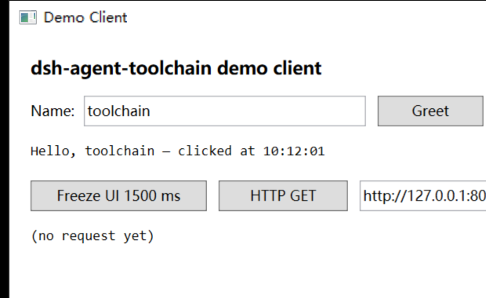

# dsh-agent-toolchain

**The engineering runtime that lets coding agents check their own changes against the running application, and keeps the evidence.**

[](./LICENSE)
[](https://github.com/lemonmmice/dsh-agent-toolchain/releases)
[](https://nodejs.org)
[](./mcp/README.md)

A suite of plugins and an MCP server that let a coding agent do more than write code — it can *see* the running desktop application, *drive* it, *measure* it, and *capture* what it sends over the network, to check the change it just made. Each plugin is a small, composable building block; together they close the loop between "the agent wrote a change" and "the change actually works" — and keep the evidence of what they checked.



One command runs the whole loop against a throwaway WPF window that ships in this repo — build it, launch it, drive it, and read the result back out:

```bash
npm run demo          # build → launch → drive → read
npm run demo:perf     # + catch a deliberately blocked UI thread
```

Real output (`npm run demo`, opening banner omitted):

```
1. environment self-check
  ok   toolchain_status reports what is configured  (toolchain_status, 542 ms)

2. build the sample app (and bind the result to a runId)
  ok   build_run → 0 errors  (build_run, 3353 ms)

3. launch and look at the real window
  ok   ui_launch brings the window up  (ui_launch, 11929 ms)
  ok   ui_observe(state) sees the controls  (ui_observe, 62 ms)

4. drive it — this is the part a code-reading agent cannot do
  ok   type into the Input box  (ui_drive, 458 ms)
  ok   click Greet  (ui_drive, 314 ms)
  ok   read the result back out of the UI  (ui_observe, 79 ms)
  ok   capture a screenshot as evidence  (ui_observe, 35 ms)

steps: 8/8 ok
```

`npm run demo:perf` additionally reports `stutterCount=1, maxMs=1474` — the sample app blocks its UI thread for exactly 1500 ms on purpose, and the perf probe has to catch it.

> The demo is not demo-only code. `mcp/demo/run-demo.mjs` is an ordinary MCP client: it spawns `mcp/server.mjs` over stdio and calls the same tools Claude Code, Cursor, Cline or Codex would call. If it passes, the MCP face works.

> Recording a GIF: `npm run demo:perf` while a screen recorder is running is the intended capture — the window does something visible at every step. `docs/media/` is where the recording goes.

## The problem

Coding agents are excellent at producing patches, but they are blind to what happens after the patch: Did the build break? Did the UI actually render the new page? Which API calls did the application fire, and did one of them hang for 20 seconds? Did the change introduce a memory leak or a UI stall?

Traditional agents verify by reading code. This toolchain lets them verify by *observing the running application* — the same way a human QA engineer would — and keeps the evidence (build logs, screenshots, captures, dumps) on disk.

## The loop

```
  change code → build (dsh-build) → drive client (dsh-ui-drive)
                                      → capture / mock APIs (dsh-api-visualizer)
                                      → replay requests, run collections (dsh-postman)
                                      → inspect perf (dsh-perf) / hang (dsh-hang-inspector)
                                      → remember lessons (dsh-memory)
  failures record themselves → failure corpus (the data flywheel, internal)
  a lesson worth keeping → harness_trial (Harness²) → validated project skill (optional)
```

## Quick start

### Path A — the demo path (no Rust, about five minutes)

The tools `npm run demo` exercises — `toolchain_status`, `build_run`, `ui_launch` / `ui_observe` / `ui_drive`, and `perf_probe` with `--with-perf` — need **neither Rust nor MSVC**, and neither does `http_request`. Verified on a checkout whose `plugins/*/bin/` directories are empty.

1. Node.js 20+ and a .NET SDK (the sample targets `net10.0-windows`).
2. `npm install --prefix mcp` — the MCP server is the only thing with a dependency.
3. `npm run demo`.

Apart from the sample's own build output (`samples/DemoClient/bin/` and `obj/`, gitignored), a demo run keeps its screenshots, build log and any failure records under `.dsh-agent-toolchain/demo/` (gitignored).

### Path B — full desktop mode

An optional standalone Rust MCP runtime is available through `npm run build:runtime`.
It runs HTTP, background tasks and evidence publication without Node, and can
retain the complete tool catalog through a lazy Node compatibility bridge.
See [Rust runtime scope, deployment and validation](./docs/native-runtime.md).

The API-capture store, the memory index and flame folding load Rust Node-API modules, and the terminal inspector runs a small Rust helper executable. Build the ones you need (Rust + Visual C++ build tools), or take a deployment that already ships them:

```bash
npm run build:capture-store        # dsh-api-visualizer (+ shared by dsh-verify)
npm run build:memory-store         # dsh-memory
npm run build:trace-fold           # dsh-perf flame folding
npm run build:terminal-inspector   # dsh-win-terminal-inspector
```

Then run `pwsh -File install.ps1` for a dry run, or `pwsh -File install.ps1 -Apply` to copy the plugins and `lib/` into your DSH profile. Registering them in `cordis.patch.yml` ([Install (details)](#install-details)) and restarting the host are left to you; the script prints them as next steps.

## What this does that a code-reading agent cannot

- **Tell the difference between "0 errors" and "the file was compiled".** Legacy `.csproj` projects do not include new `.cs` files automatically, so a build can report success while your file was never compiled. `build_compile_check` answers that question specifically, with three states — in the compilation set, not in it, or *cannot tell* (unevaluated conditions, missing or ambiguous inputs; never silently "not"). It reads the project files statically; it is not an MSBuild evaluation.
- **Operate and observe the real application.** `ui_observe` / `ui_drive` / `ui_flow` find controls by name or AutomationId, click, type, wait for conditions, read values back, and capture window-scoped screenshots. Read-only actions never need permission; anything that clicks or types must pass `allowSideEffects=true`, and an optional snapshot-freshness gate rejects actions aimed at a stale UI.
- **Jev-assisted UI decisions.** `ui_jev` sends a sanitized UIA control list to Jev and lets it pick one bounded candidate per step (up to `maxSteps`), then runs it through the same deterministic UI executor and safety gates. It sends nothing without `allowRemoteData=true` and executes nothing without `allowSideEffects=true`. Jev never receives pixels, generates arbitrary input, or bypasses authorization; see [docs/jev-ui.md](./docs/jev-ui.md).
- **Say "unverified" instead of "passed".** When a tool cannot see something, it reports it as unchecked rather than inventing a green result — an empty enumeration is "not read", not "nothing there", and a build reporting 0 errors is not the same claim as "your file was compiled".

## Tools — 68, of which 25 are read-only

The single source of truth is [`lib/tool-registry.mjs`](./lib/tool-registry.mjs); both faces (DSH plugins and MCP) are generated from it, so they cannot drift apart. **Every tool, one line each, sorted by what you are trying to do → [docs/tools.md](./docs/tools.md).**

| Plugin | What it does for the agent |
| --- | --- |
| [dsh-build](./plugins/dsh-build/README.md) | Run MSBuild / `dotnet build` as a tool: incremental build, structured error list (file/line/col/code), error re-parse, compile-membership check. Build defaults auto-resolve by repo layout (legacy client layouts keep their defaults byte-for-byte; stock repos get `.sln`/`.slnx` + platform auto-detection). Also hosts the optional `dev_*` tools: C# language-server queries, local log search, .NET skills, encoding-preserving file read/edit, public docs lookup and PNG diff. |
| [dsh-ui-drive](./plugins/dsh-ui-drive/README.md) | Drive a running Windows desktop client via UIA: find/click/type/read/screenshot, visual-tree dumps, multi-step flows with assertions and replay. Screenshots come back as files for the calling model to read; a vision model is used only by the opt-in click fallback. |
| [dsh-verify](./plugins/dsh-verify/README.md) | Toolchain-status and Harness² surface: `toolchain_status` / `toolchain_job` environment self-check and job control, plus `harness_trial` / `harness_experience`. (Name kept for id stability; it no longer does verification.) |
| [dsh-api-visualizer](./plugins/dsh-api-visualizer/README.md) | Capture the client's HTTP traffic: live panel, JSONL store (optionally one per client), caller attribution, saved filters, baseline/contract regression, Markdown export for AI analysis, an optional Fiddler-style local proxy, and transparent interception for clients that ignore proxy settings (a hosts-file redirect that needs elevation or a UAC prompt and registers a SYSTEM safety-net task). Traffic through the proxy or the interception can be mocked, mapped to a local file or another host, rewritten, paused at breakpoints, or slowed down. |
| [dsh-postman](./plugins/dsh-postman/README.md) | Postman-style HTTP client inside the harness: compose/send requests from the host (no browser CORS), history store, collections with folders, environments, assertions and variable extraction, a collection runner, WebSocket client, `http_request` / `http_collection` agent tools. |
| [dsh-perf](./plugins/dsh-perf/README.md) | UI stutter measurement (window-message latency, P50/P95/P99, stutter events), full-dump capture + ClrMD analysis, managed-heap stats, GC-root retention paths, ETW trace / hotstacks / flame and allocation folding, UI-freeze (wall-clock) analysis, offline CPU-sample breakdown by thread, time window and method group. |
| [dsh-hang-inspector](./plugins/dsh-hang-inspector/README.md) | Hang diagnosis: monitor main-window responsiveness, auto-collect evidence packs (frozen screenshot, timeline, process info, net-trace tail, dump), analyze the managed thread stack and map the hang to project source. |
| [dsh-memory](./plugins/dsh-memory/README.md) | Long-term memory for the harness: semantic search over indexed workspace docs, cross-session key-value conventions, mtime-incremental indexing, stale-chunk eviction, token/secret filter on save. |
| [dsh-win-terminal-inspector](./plugins/dsh-win-terminal-inspector/README.md) | Windows terminal (ConPTY) inspection for persistent shells. |
| [dsh-jev](./docs/jev-integration.md) | Optional TypeSafe Jev decision layer: batched typed routing/evidence judgments with explicit remote-data opt-in; advisory only, never executes a selected action. |

**Highlights**

- **One toolchain, every agent**: the same tools power the DeepSeek Harness plugins **and** any MCP client — see [mcp/](./mcp/README.md). Claude Code, Cursor, Cline and Codex can drive the client, run builds, capture APIs and search memory with the exact same `lib/` code. Capture control, mocking, interception and weak-network simulation forward to the DSH host that owns the capture engine, so they need it running.
- **Safety-first UI automation**: `click`/`setvalue`/`key` require an explicit `allowSideEffects=true`; read-only operations are always safe. An operational kill switch and an optional deny-first policy sit above every action, and recovery is deliberately not an agent tool.
- **Honest measurement**: perf numbers come from real window-message round trips and each report prints what the method *cannot* see; cost tables say "unknown" instead of inventing numbers; an empty enumeration is reported as "not read", never as "nothing there".
- **The failure corpus is the moat**: failure paths record themselves under a fixed 7-class taxonomy — build errors and `ui_flow` failures (assertions or action steps) on both faces, and on the MCP face also failed UI actions, HTTP requests that could not be sent, failed hang analyses and UI stalls caught by `perf_probe`. The corpus is an internal store written by the runtime; no agent-callable tool reads or writes it. See [docs/failure-corpus.md](./docs/failure-corpus.md).
- **Loopback-only control APIs**, and the environment-specific values (client exe, window title, evidence dirs, tool paths, source roots) are environment variables with sane defaults: no hard-coded machines, no embedded credentials. The one fixed value is the address the MCP face uses to reach the DSH host, `127.0.0.1:3080`. One opt-in tool changes system configuration: `capture_intercept start` edits the system hosts file (with a UAC prompt when the host is not elevated) and registers a SYSTEM scheduled task that removes the block on reboot or when the listener is gone; `stop` restores the file.

## Works with any MCP client

```bash
claude mcp add --scope user dsh-agent-toolchain -- cmd /c node <repo>\mcp\server.mjs
```

Cursor, Cline and other stdio clients take the same command. Configuration details, progress notifications, output budgets and the honest platform matrix live in [mcp/README.md](./mcp/README.md).

## Install as an agent plugin (MCP server + skills + hooks)

The repository root is also a plugin (`.claude-plugin/plugin.json`, listed by `.claude-plugin/marketplace.json`). One install brings three things together:

- **the MCP server** — started through `mcp/launch.mjs`, which installs the MCP SDK on first start if `node_modules` is missing and reads this machine's settings from `~/.dsh-agent-toolchain/env.json` (`DSH_ENV_FILE` to move it, `none` to disable; only `DSH_*` string values, never `DSH_CRED_*`). Like the `env` block of a `claude mcp add -e …` registration, the file **overrides** inherited environment variables of the same name;
- **five workflow skills** under `skills/` — UI self-check, API capture, perf triage, hang triage, build/compile-set check — loaded on demand instead of 68 tool descriptions doing all the teaching;
- **two hooks** (`hooks/hooks.json`):
  - `PostToolUse` — writing a `.cs`/`.vb`/`.fs` file that a legacy project does not list for compilation gets an immediate warning (same static reading as `build_compile_check`; undecidable cases stay silent).
  - `SessionStart` — in a .NET repo, a few lines on what is connected and **which process the UI/perf tools will act on**, with a warning when that target's source root is not the repo you are in.

```bash
claude plugin marketplace add lemonmmice/dsh-agent-toolchain
claude plugin install dsh-agent-toolchain@dsh-agent-toolchain
```

For local development, load the checkout in place instead of a cached copy (Claude Code auto-loads plugins under `~/.claude/skills/<name>/`), so edits take effect in the next session — Windows: `mklink /J %USERPROFILE%\.claude\skills\dsh-agent-toolchain <repo>`. Plugin-provided tools are namespaced, e.g. `mcp__plugin_dsh-agent-toolchain_dsh__build_run`; remove a separate `claude mcp add` registration of the same server to avoid two copies of every tool.

Codex reads `.claude-plugin/plugin.json` and `.claude-plugin/marketplace.json` as alternate manifest locations (upstream `codex-rs/exec-server-protocol` and `codex-rs/core-plugins`), so the same layout is meant to load there too — **not yet verified end to end**.

## Install (details)

Each plugin is a drop-in host plugin. Copy the plugin directory into your DSH profile's `plugins/` and register it in `cordis.patch.yml`. The panels (`dsh-api-visualizer`, `dsh-postman`, `dsh-hang-inspector`) are registered by package name, so `node_modules/@dsh-agent-toolchain/<name>` has to resolve to that copy, for example as a junction to `plugins/<name>`:

```yaml
- insert:
    - id: ui-drive
      name: './plugins/dsh-ui-drive/index.js'
```

`scripts/deploy-plugins.mjs` (wrapped by `install.ps1`) is the supported way to do that copy; it copies into `plugins/` and `lib/`, writes a `.dsh-toolchain-deploy.json` deploy stamp at the profile root, never touches `node_modules`, and `--check` reports drift without writing.

**Shared `lib/`:** every plugin except `dsh-win-terminal-inspector` imports modules from the repo-root `lib/` (all of them `tool-registry.mjs`; `dsh-verify` also loads the Harness² core from `lib/harness/`, which in turn uses `lib/verify/` and `plugins/dsh-memory/lib/`). Their relative imports resolve against the **profile root**, so the profile needs a copy of the monorepo `lib/` tree. `scripts/deploy-plugins.mjs` copies the whole tree and reports its drift separately from the plugins:

```
<profile>/
  plugins/dsh-build/...     # each plugin dir copied as-is
  lib/                      # the repo's lib/ tree, copied as a whole
    tool-registry.mjs
    harness/...
    verify/...
```

Missing shared modules make the plugin crash at load (static imports). The `failure-corpus` dynamic imports in `dsh-build` and `dsh-ui-drive` degrade to no-ops; `dsh-verify` loads `toolchain-status` and the Harness² core (`core`, `executor` and `experience` under `lib/harness/`, and through them `lib/verify/` and `plugins/dsh-memory/lib/`) lazily, so a missing copy of those shows up as an error from that tool call.

Then restart the host, and ask the agent for `toolchain_status` — it reports what is configured, from which source (process env / user registry / unset), and what cannot be checked.

## Platform scope (honest)

The evidence tools (capture, memory, http), the internal failure corpus, the `dotnet` build engine and build-target resolution are not tied to Windows, but capture and memory need their Rust Node-API module built for the platform, and only Windows x64 has been validated. UI-driving, the VS-MSBuild engine, the perf/hang probes and transparent interception (`capture_intercept`) are Windows-only; elsewhere they report `unconfigured` or return an explicit error rather than pretending. The per-tool matrix is in [mcp/README.md](./mcp/README.md#platform-scope-honest); the compatibility matrix (harness × plugin × MCP versions) is in [docs/compatibility.md](./docs/compatibility.md).

## How this was built

This repository is meant to be a working example of its own argument, so the process is part of the artifact rather than a footnote:

- **One implementer, two independent reviewers.** Work is implemented here, then handed read-only to **Codex** and **Claude** separately, each asked to *falsify* rather than agree ("the valuable output is what I claimed without evidence, plus counter-examples that break it"). Rounds routinely end with some findings accepted and fixed, and others rebutted with evidence — the reviewers are not agreed with for the sake of agreement.
- **An accepted finding becomes a guard in code, not a paragraph.** That is why dozens of comments name the round that produced them (`Codex r30`, `Codex r37`, `Codex r54`, `Codex 第十二轮`): a review conclusion that is not executable decays immediately.
- **The review outcome is itself adjudicated.** The 2026-09-11 cross-model review round was closed with the claims-vs-evidence engine in `lib/verify` (internal since the agent-callable `verify_report` tool was removed on 2026-11-04). The verification records themselves are local and not in this repository.
- **The failure corpus stores who found what** ([docs/failure-corpus.md](./docs/failure-corpus.md)). Its taxonomy includes `agent-misjudge` (the agent claimed success, the evidence disagreed); since `verify_report` was removed on 2026-11-04, nothing records that class automatically.

## Prior art & acknowledgements

What this project learned from, package by package and file by file — including what was deliberately **not** taken, and an honest inventory of the review reports that are *not* in this repository — is collected in **[docs/prior-art.md](./docs/prior-art.md)**.

At a glance:

- **[OpenAI Codex](https://github.com/openai/codex) (`codex-rs`, Apache-2.0, Copyright 2025 OpenAI)** — the largest single influence. A 76-file subset of its workspace was studied locally; what was taken is *interface shape, policy structure and naming discipline* (the Guardian approval layer, the tool-spec registry, the call-trace discipline, the computer-use access control model, the truncation policy). **No Codex source is vendored here and no file was copied** — every implementation is an independent re-implementation, and `native/**/*.rs` contains no Codex references. Codex is also a *subject*: `bench/harness/bench.mjs` runs it as an agent under test.
- **Anthropic and OpenAI's harness writing, and Mitchell Hashimoto's formulation** — the framing this project works inside; the failure corpus is Hashimoto's "design a solution so the agent never makes that mistake again" turned into storage.
- **[PerfView](https://github.com/microsoft/perfview)** — the reference implementation for the perf plugin's trace, hotstacks, flame and GC views. [docs/perfview-parity.md](./docs/perfview-parity.md) tracks the gaps as well as the matches.
- **ClrMD / DumpStack, ETW (xperf/WPR), WinDbg (`cdb`)** — wrapped and parsed, with the traps recorded in [docs/native-stacks.md](./docs/native-stacks.md).

## Docs

| Doc | What is in it |
| --- | --- |
| [ROADMAP.md](./ROADMAP.md) | The public three-year plan and its design principles |
| [docs/architecture.md](./docs/architecture.md) | How the pieces compose |
| [docs/tools.md](./docs/tools.md) | All 68 tools, one line each, grouped by what you are trying to do |
| [docs/prior-art.md](./docs/prior-art.md) | What this project learned from (per package), and what it deliberately did not copy |
| [docs/verify-package.md](./docs/verify-package.md) | Proposal: extracting the verification core as a standalone package — **status: not implemented** |
| [docs/harness2-integration-design.md](./docs/harness2-integration-design.md) | Harness² source assessment and DSH integration design |
| [docs/harness2-executor.md](./docs/harness2-executor.md) | Harness² execution adapter, evidence boundaries and evaluation limits |
| [bench/README.md](./bench/README.md) | The evaluation bench: SWE-bench-style tasks with hidden verification. Results, including the ones later retracted, are in [bench/pilot/report.md](./bench/pilot/report.md) |
| [docs/perfview-parity.md](./docs/perfview-parity.md) | The perf plugin measured against PerfView, gaps included |
| [docs/native-runtime.md](./docs/native-runtime.md) | The optional Rust MCP runtime: scope, deployment and validation |
| [docs/failure-corpus.md](./docs/failure-corpus.md) | Failure taxonomy and record schema |
| [docs/agent-toolchain-evaluation.md](./docs/agent-toolchain-evaluation.md) | A 2026-09-20 measurement snapshot of this toolchain (53 tools at the time), plus what was still weak (in Chinese) |
| [docs/ui-drive-safety-boundary.md](./docs/ui-drive-safety-boundary.md) | What UI automation is allowed to do |
| [CHANGELOG.md](./CHANGELOG.md) | SemVer history (Keep a Changelog) |

## Contributing

See [CONTRIBUTING.md](./CONTRIBUTING.md). `npm run check` is the repo gate: syntax, forbidden references, no nested `.git`/`node_modules`, no tracked local-only benchmark paths, tool-schema DSL, PowerShell encoding, and plugin prompt sections registered with `interpolate: false`.

## License

Apache-2.0; see [LICENSE](./LICENSE).
